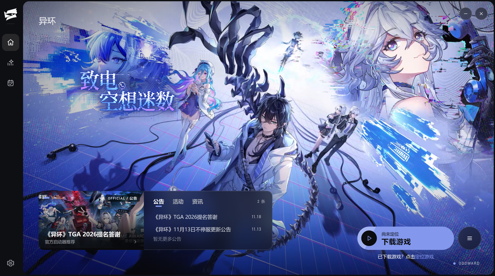

# Oddward

**《异环》国服的免费开源启动器**

**[下载安装包](https://github.com/nerv-base/Oddward/releases/download/v0.1.0/oddward-0.1.0-setup.exe)** · [发行说明](https://github.com/nerv-base/Oddward/releases/latest) · [问题反馈](https://github.com/nerv-base/Oddward/issues)

Oddward 是面向《异环》国服的第三方启动器。你可以用它管理已有安装和多个账号，从首页查看官方公告，也可以在启动器里整理抽卡记录和查看签到状态。界面使用 Go 和 [MyGo](https://github.com/egoist/mygo) 构建。

## 主要功能

- **下载与更新**。从官方 CDN 下载游戏资源，校验和修复已有安装。更新时优先使用可用的官方差分补丁，下载支持暂停和断点续传。官方开放预下载时，可提前下载更新资源。
- **游戏启动与账号管理**。支持国服手机号验证码登录和多账号切换，可选保存常用账号。续期凭据由 Windows DPAPI 加密保护。
- **抽卡记录与签到**。按角色整理、统计、导入和导出抽卡档案。关联塔吉多后可手动同步近期 S 级记录，并查看游戏和社区签到、今日活跃度及周本剩余。自动签到默认关闭，可分别开启。
- **官方公告与外观**。首页轮播官方公告和活动封面，离线也可查看缓存列表和已读正文。默认加载官方版本背景，也可以指定本地视频、静态图、标志和标语。

## 开始使用

1. 在 **Windows 10 / 11 x64** 上下载并运行 Oddward 安装包。
2. 已有《异环》国服安装时，在主页点击「定位游戏」，选择游戏安装目录。若尚未安装，建议先完成国服安装，再回到 Oddward 定位。[《异环》官网](https://yh.wanmei.com/)
3. 定位后，可从主页启动游戏或检查更新。左侧齿轮打开启动器设置，主按钮旁的齿轮管理游戏目录和下载偏好。

游戏启动和登录依赖安装目录中的官方启动组件。Oddward 的「下载游戏」负责下载游戏资源。

[从源码构建](docs/building.md) · [贡献指南](CONTRIBUTING.md) · [开源许可](LICENSE)

Oddward 是非官方项目。游戏名称、商标及素材归原权利人所有。
